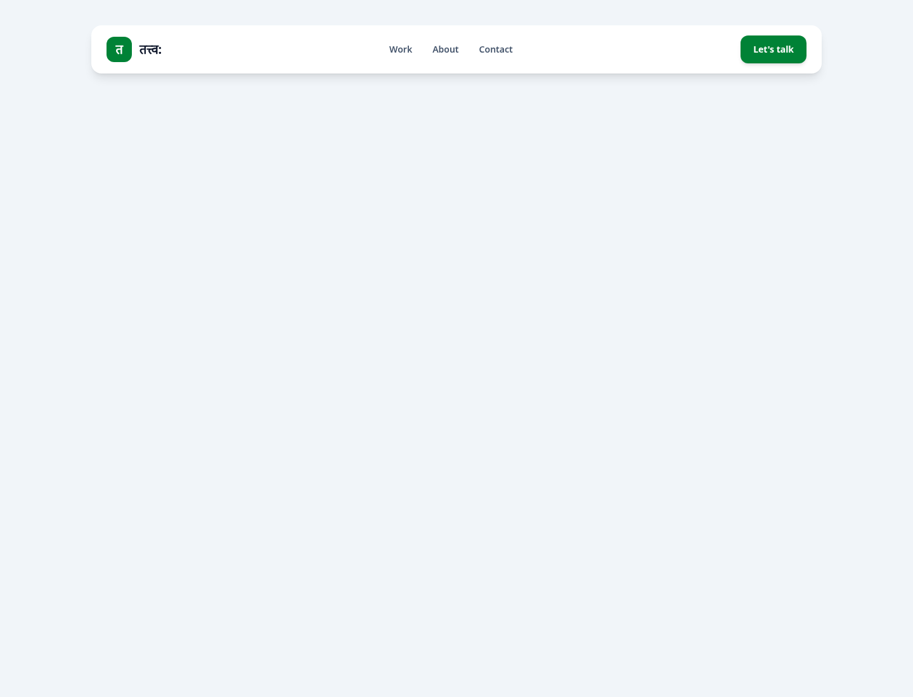
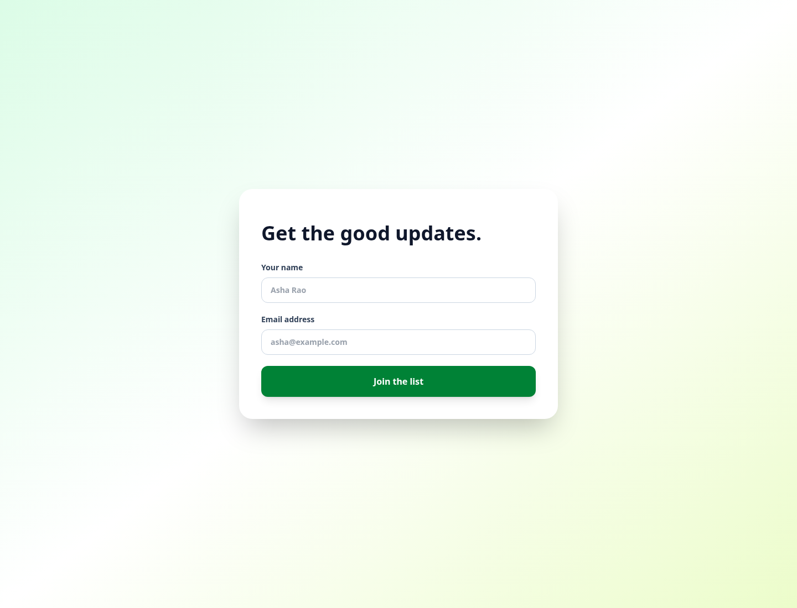
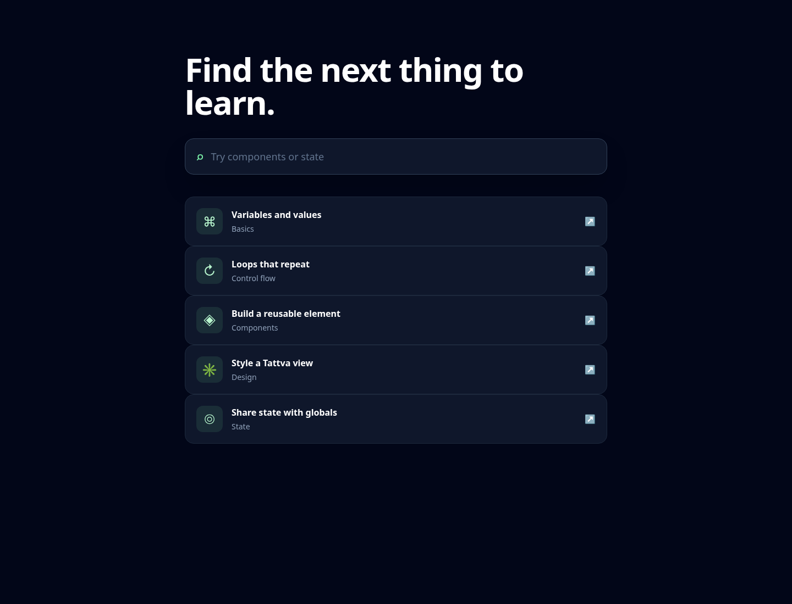
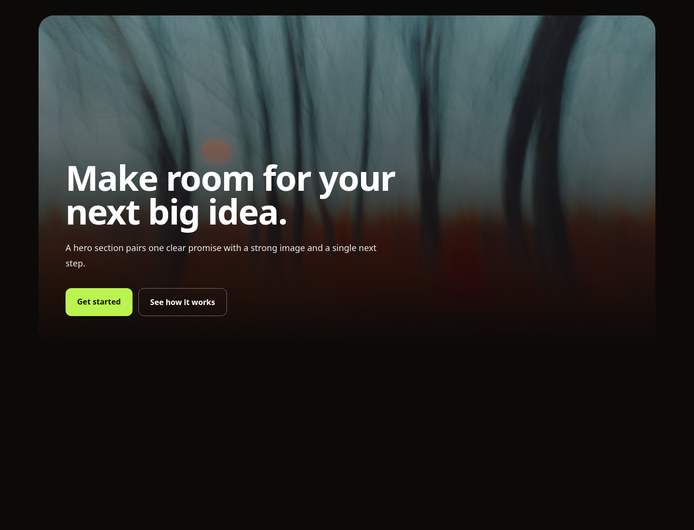
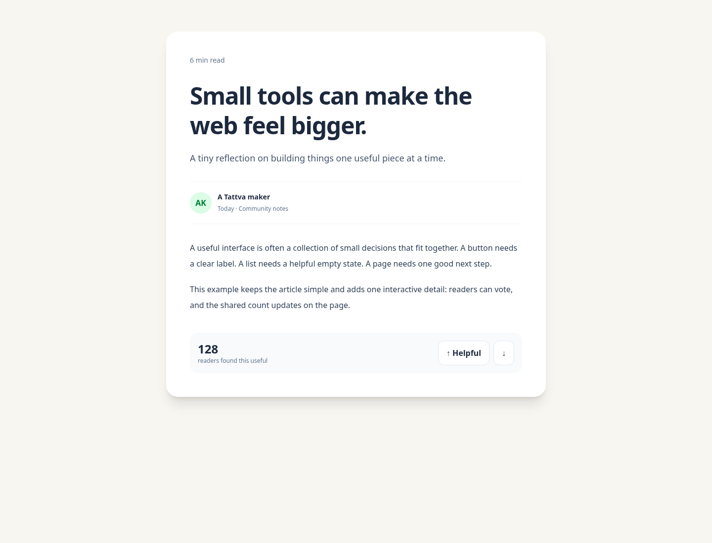
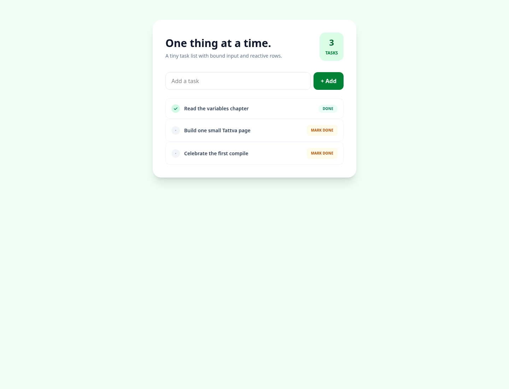
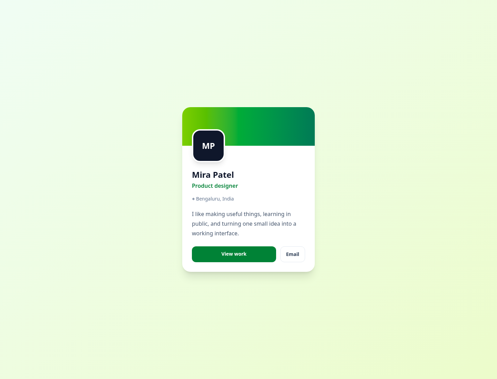
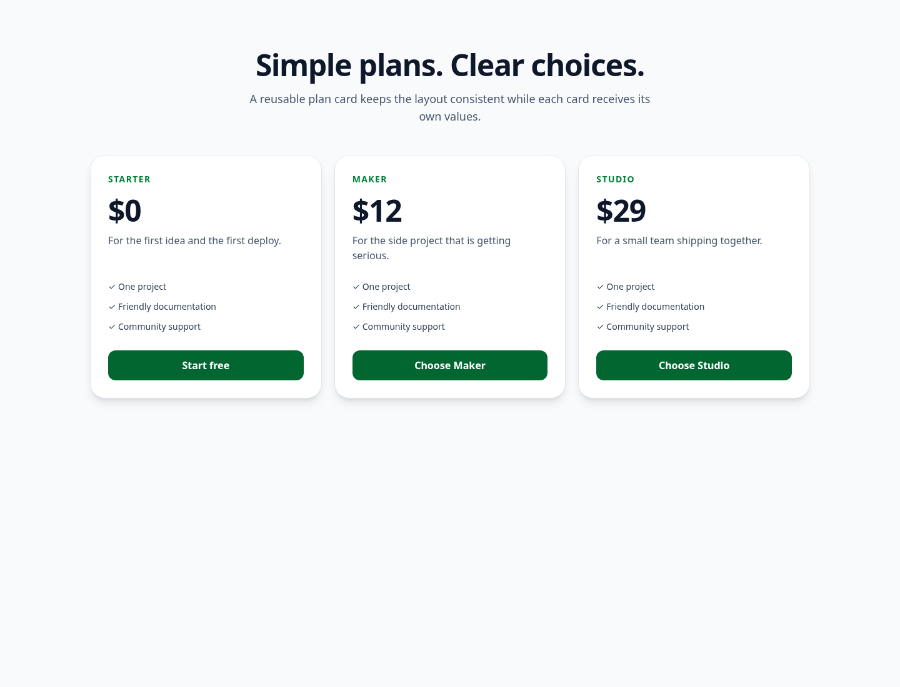
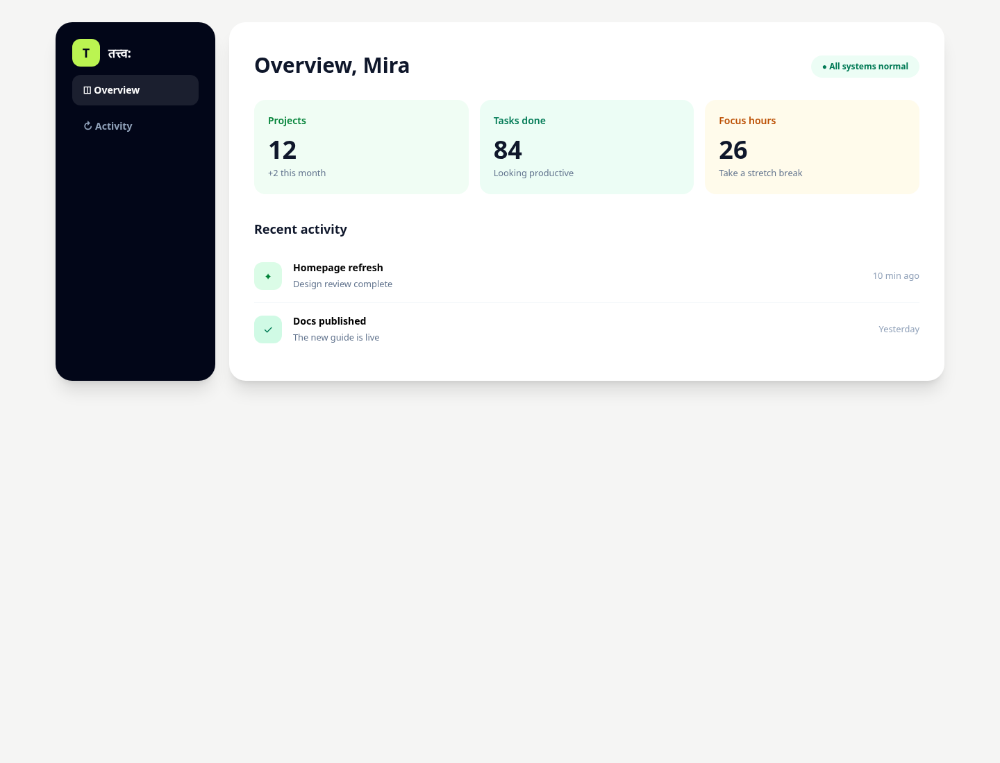
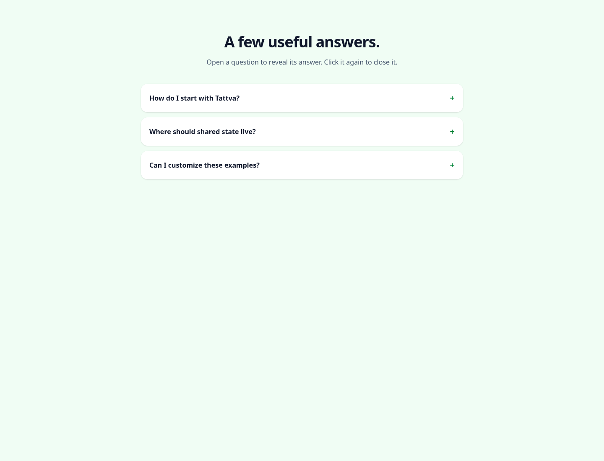

# तत्त्व: - Tattva

<div align="center">
  

  <h1>तत्त्व: - Tattva</h1>

  <p>A tiny language project born from a developer getting frustrated with modern web frameworks.</p>

  

  <p><em>(Yes, even the documentation is built in तत्त्व:.)</em></p>
</div>


## Why तत्त्व:?

<div align="center">
  
</div>

---

Well, React JS and the growing family of hooks, prop drilling, and frequent library updates started to feel like a lot to keep up with. You pick up a library, get comfortable with it, and a few months later, boom! Something has changed.

I wanted a simpler way to build websites for my own use, so I started thinking about a language where elements are first-class building blocks.

I wanted something inspired by the object-oriented paradigm, with simple state tracking and a way to build interfaces without depending on an ever-growing collection of libraries.

The idea eventually became **तत्त्व:**.

I picked the Sanskrit name because the language is built around the fundamental elements of a page: elements, state, and views.

## What makes it special?

<div align="center">
  
</div>

---

Honestly, nothing much.

While building तत्त्व:, I discovered Svelte, which was already pretty close to the kind of experience I had in mind.

I kept going anyway, partly because the idea was fun and partly because I had already promised a friend that I would finish this project.

तत्त्व: is a work in progress. I am learning as I build it, experimenting with ideas, and figuring out the design along the way.

## How I built it

<div align="center">
  
</div>

---

Initially, I wanted to make something that would make everyone look at the screen and say, "Bro, wow!"

Then I searched around and realised that making an entire programming language is quite an undertaking.

The first practical plan I came up with was:

1. Design the syntax.
2. Parse the source code.
3. Translate it into reactive vanilla JavaScript.

That is still the basic shape of the project.

I started learning about parsing, and the compiler now uses a handwritten lexer and a recursive-descent parser.

I also spent time understanding visitor patterns and Pratt parsing, partly thanks to the excellent [Crafting Interpreters](https://craftinginterpreters.com/) book. The current expression parser is recursive descent.

I started writing everything by hand, but eventually hit the wall. I was getting tired of writing repetitive code.

So I brought in my best AI friends and became the orchestrator, a bit like Sergio Busquets directing play from midfield.

I describe the idea, let AI help draft the implementation, and then inspect, understand, and verify the generated code.

<div align="center">
  
</div>


## A little about the design

<div align="center">
  
</div>

---

My first design idea was to put everything into one global state table.

That fell apart pretty quickly when multiple copies of the same element needed to maintain separate state.

I had to rethink the architecture:

- **Global state table:** Values shared across the application.
- **Local state table and registry:** Maintained separately for each rendered element or component instance.

The generated runtime gives reactive nodes unique IDs and registers the values they depend on.

Local nodes register themselves inside their own component.

When a global value changes, the runtime can find the registered nodes that depend on it and refresh them.

Local updates use their own maps, allowing two instances of the same element to maintain completely separate state.

This is the current prototype architecture.

There are still some known gaps, including:

- Nested list and map updates.
- Stable element identity.
- Lifecycle management.
- Updates that span component boundaries.

A lot of the runtime design is still evolving.

## What can you do in तत्त्व: right now?

<div align="center">
  
</div>

---

The compiler is written in C++.

It reads `.ttv`, `.tattva`, and `.web` files and generates:

- `index.html`
- `style.css`
- `app.js`

### The current prototype can compile

- App configuration, pages, simple layouts, and exact-path navigation.
- Elements with named parameters, fields, methods, and views.
- HTML-like tags, text, attributes, and common event handlers.
- Global values, persisted globals, and basic derived values.
- Numbers, strings, booleans, `none`, lists, maps, lambdas, and common operators.
- Conditions, loops, functions, and basic error-handling syntax.
- Raw CSS blocks and JavaScript interop blocks.
- Basic generated model CRUD helpers and record proxies.

Some features are more complete than others. Syntax support does not necessarily mean every associated runtime behaviour is finished.

## Examples

Here are ten small projects that demonstrate what you can build with the current compiler.

Each example has its own source file and screenshot. They are also available as separate routes in the [Documentation Site](https://aaklon.github.io/Tattva/).

| Example         | Source                                               |                                           Preview                                            |
| :-------------- | :--------------------------------------------------- | :------------------------------------------------------------------------------------------: |
| Navbar          | [Source](documentation/sources/navbar.tattva)        |                |
| Form            | [Source](documentation/sources/form.tattva)          |                    |
| Search bar      | [Source](documentation/sources/search-bar.tattva)    |        |
| Hero section    | [Source](documentation/sources/hero-section.tattva)  |    |
| Blog with votes | [Source](documentation/sources/blog-votes.tattva)    |   |
| Todo list       | [Source](documentation/sources/todo-list.tattva)     |          |
| Profile card    | [Source](documentation/sources/profile-card.tattva)  |    |
| Pricing cards   | [Source](documentation/sources/pricing-cards.tattva) |  |
| Dashboard       | [Source](documentation/sources/dashboard.tattva)     |          |
| FAQ accordion   | [Source](documentation/sources/faq.tattva)           |                      |

The [Documentation Site](https://aaklon.github.io/Tattva/) combines the guide and all ten examples into one Tattva project.

Each example route includes its corresponding source code.

The documentation site source is available at [`documentation/documentation.tattva`](documentation/documentation.tattva).

## How to compile your code

You need a C++17-compatible compiler such as `g++` or `clang++`.

### 1. Build the compiler

From the repository root:

```sh
make build
```

### 2. Compile your Tattva project

Pass the source folder and output folder as arguments:

```sh
./parser path/to/source path/to/output
```

For example, to compile the guide and all examples together:

```sh
./parser documentation documentation/dist
```

The compiler reads supported source files directly inside the input folder. It does not search nested folders.

The output folder contains:

```text
index.html
style.css
app.js
```

### Alternatively, use the Makefile

```sh
make compile DIR=documentation OUT=documentation/dist
```

## Documentation

<div align="center">
  
</div>

---


The documentation is itself written in तत्त्व:.

Start with the [Documentation](https://aaklon.github.io/Tattva/). It includes beginner lessons and ten example routes, each with its corresponding Tattva source code.

**Live preview:**

## What is coming in the future?

<div align="center">
  
</div>

The goal is to turn this prototype into a much more complete language.

There are still plenty of difficult compiler and runtime decisions ahead. I am also lazy enough to make no promises about the timeline.

Here are some things I would like to work towards:

- **Reactivity:** Reliable updates for fields, globals, derived values, and nested lists, maps, and records.
- **Components:** Stable element instances, lifecycle behaviour, and working default and named slots.
- **Views:** Complete view behaviour, including forms, two-way binding, references, keyed loops, and safe attributes.
- **Routing:** Route patterns, route parameters, query values, wildcard pages, and persistent layouts.
- **Models:** Typed model fields, validation, CRUD operations, and browser storage.
- **Asynchronous operations:** Async functions, `await`, network helpers, timers, and timer cleanup.
- **Error handling:** Clear compiler errors for syntax, names, scope, routes, models, and invalid view composition.
- **Developer experience:** A local server, automatic reloads, formatting, source maps, and browser compilation.

Fingers crossed I ship a few of these.

## Want to contribute?

You absolutely can.

Clear bug reports, small fixes, examples, and thoughtful design discussions are welcome.

This is a learning project, and contributions are a great way to help shape what it becomes.

## License

तत्त्व: is available under the [MIT License](LICENSE).
